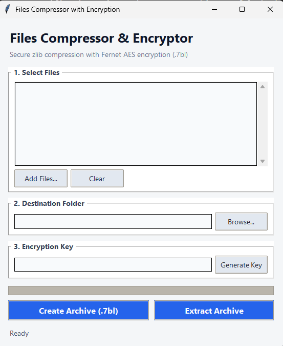

# Files Compressor with Encryption

#### Author: Sharan Kumar R ([@sharankumar-r](https://github.com/sharankumar-r))

[](LICENSE)
[](https://www.python.org/)
[-orange?style=for-the-badge)](https://cryptography.io/)
[](https://github.com/sharankumar-r/Files-Compressor-Encryption)

---

## Overview

**Files Compressor with Encryption** is a desktop utility that bundles file compression and symmetric encryption into a single streamlined workflow. It reduces file sizes using maximum `zlib` compression and secures the payload using Fernet (128-bit AES in CBC mode with HMAC SHA-256 authentication).

Archived files are packaged into `.7bl` archives, protecting sensitive personal and business files against unauthorized access and tampering.

---

## Application Interface

<p align="center">
  
</p>

---

## Features

- **High-Ratio Compression**: Compresses files using `zlib` at `Z_BEST_COMPRESSION` to optimize storage footprint.
- **Strong Encryption**: Protects archive payloads with Fernet authenticated cryptography (AES-128-CBC + HMAC-SHA256).
- **Key Management**: Built-in 256-bit URL-safe base64 key generator with one-click generation.
- **Batch Archiving**: Select and package multiple files into a single encrypted `.7bl` archive container.
- **Safe Extraction**: Verifies integrity and extracts archives safely back into their original files.
- **Clean Desktop GUI**: Built with Tkinter and ttk — native, lightweight, and responsive across all platforms.

---

## Architecture & Specifications

| Parameter | Specification |
|:---|:---|
| **Programming Language** | Python 3.8+ |
| **GUI Framework** | Tkinter / ttk |
| **Encryption Standard** | Fernet (128-bit AES-CBC with HMAC-SHA256) |
| **Compression Engine** | `zlib` (level 9 / `Z_BEST_COMPRESSION`) |
| **Archive Format** | `.7bl` container |
| **License** | GNU General Public License v3.0 |

---

## Getting Started

### Prerequisites

- Python 3.8 or higher installed on your system.
- `pip` package manager.

### Installation

1. **Clone the repository:**
   ```bash
   git clone https://github.com/sharankumar-r/Files-Compressor-Encryption.git
   cd Files-Compressor-Encryption
   ```

2. **Install required dependencies:**
   ```bash
   pip install -r requirements.txt
   ```

---

## Usage

### Launching the Application

Run the application with Python:

```bash
python Files_Compressor_Eng.py
```

### Creating an Archive

1. Click **Add Files...** to select one or multiple files you want to secure.
2. Select a **Destination Folder** where the `.7bl` archive will be saved.
3. Click **Generate Key** (or paste an existing Fernet key). **Important**: Store this key securely; without it, the archive cannot be decrypted.
4. Click **Create Archive (.7bl)**.

### Extracting an Archive

1. Click **Add Files...** and select your `.7bl` archive file.
2. Specify the **Destination Folder** where decompressed files should be placed.
3. Enter the corresponding **Encryption Key**.
4. Click **Extract Archive**.

---

## Repository

- **GitHub Repository**: [https://github.com/sharankumar-r/Files-Compressor-Encryption](https://github.com/sharankumar-r/Files-Compressor-Encryption)
- **Author**: [Sharan Kumar R](https://github.com/sharankumar-r)

---

## License

This project is licensed under the **GNU General Public License v3.0** - see the [LICENSE](LICENSE) file for details.
